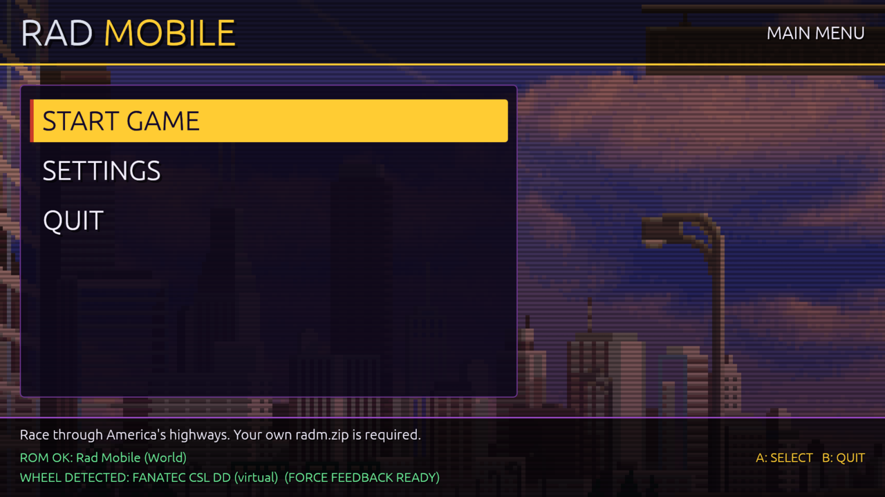
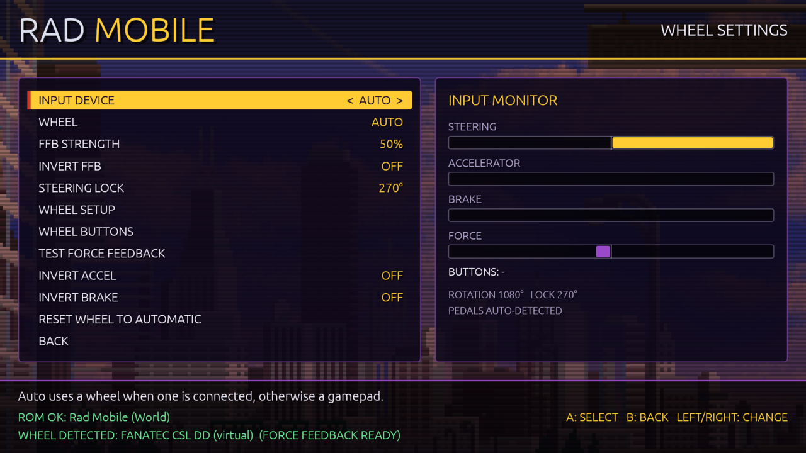
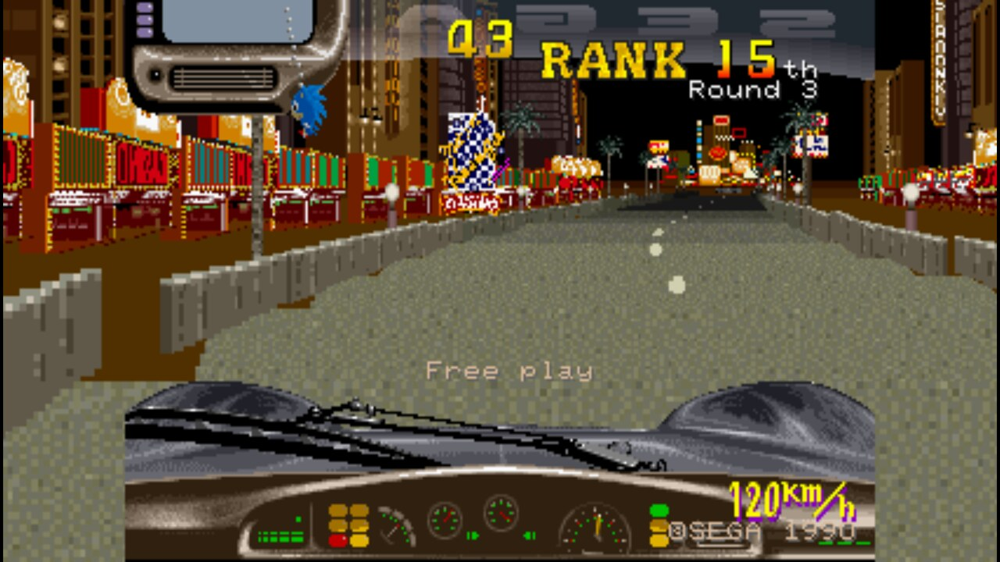
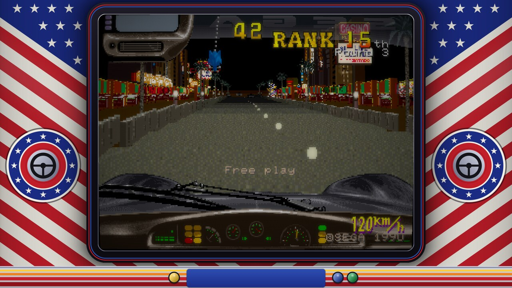

# Rad Mobile

Play Sega's **Rad Mobile** (1990, System 32) on Windows and Linux with a
steering wheel or a gamepad. One download: a menu you drive with your
wheel or pad, a bundled and patched MAME, true widescreen, CRT filters,
and force feedback. Built in the spirit of
[Wanszai](https://github.com/wanszai)'s arcade ports.

**No ROMs are included.** You need your own Rad Mobile ROM zip.

| | |
|---|---|
|  |  |
|  |  |

## Isn't this just MAME?

MAME runs Rad Mobile, but playing it well takes more than running it.
The arcade had a 270° steering wheel, two pedals and no steering motor,
and plain MAME passes your controller straight through to that hardware.
In practice:

- **Wheels steer badly.** A 900° or 1080° wheel has to turn to full lock
  before the car does, pedals on a separate USB device are hard to set
  up, and device numbers move between runs. The launcher reads the wheel
  itself, scales it to a real steering lock (270° by default, like the
  cabinet), and finds the pedals by where they rest.
- **There is no force feedback.** The cabinet had no motor, so MAME has
  nothing to send. The launcher reads the car's speed, position and
  crashes from the running game and makes the forces: centring that
  stiffens with speed, barrier scrapes, crash jolts.
- **Gamepads barely work.** The game ignores a steering reading that
  jumps further than a real wheel can turn. A stick snapping back to
  centre is such a jump, so the car kept turning after you let go. The
  patched MAME smooths it out, and the optional assisted steering lets
  the stick move the car across the road and holds its line through
  bends. No counter-steering a virtual cabinet wheel.
- **Lights and wiper buttons were keyboard-only.** MAME's driver fixed
  them to Space and Left Shift, so on a pad or wheel you could not answer
  the game's "Turn on the light" in Round 3. They are ordinary buttons
  here, and every control can be remapped.
- **It's 4:3 only.** The patched MAME draws more of the world at the
  sides at 16:9, 16:10 or 21:9 (true widescreen, not stretched).
- **Settings hide in the service menu.** Difficulty, timer, rival and
  police speed, free play and coins live in the game's EEPROM. The menu
  writes them for you, with ARCADE and EASY presets and a longer race
  clock.
- **The ROM has to be named right.** The launcher finds your zip under
  any name and rebuilds it the way MAME wants, including old sets without
  the factory EEPROM.

## What you get

| | |
|---|---|
| Wheels | Logitech, Thrustmaster, Fanatec, MOZA and generic wheels; steering lock (180°–900° or Full); separate pedal devices; a setup wizard; remap any button or pedal; invert pedals |
| Force feedback | Speed-dependent centring and damping, barrier scrape, crash jolts; strength and invert; TEST FORCE FEEDBACK; gamepad rumble |
| Gamepads | Assisted or arcade stick steering; deadzones and response curves for sticks and triggers; every button remappable |
| Video | Desktop, 1080p, 1440p or 4K; fullscreen or window; 4:3, stretch or true widescreen; Sharp, Smooth, Arcade and Trinitron CRTs after Wanszai's (curved or flat), CRT and CRT Deluxe; a cabinet bezel after the upright cabinet's stars-and-stripes art |
| Game | Difficulty, timer, race clock, rival and police speed, free play, credits, attract sound, region (World or US) |

## Install and play

1. Download the zip (Windows) or tar.gz (Linux) from
   [Releases](https://github.com/akitaonrails/rea-rad-mobile/releases)
   and unpack it anywhere. Linux needs glibc 2.36 or newer (Debian 12,
   Ubuntu 22.10, Fedora 37, Arch and newer).
2. Put your Rad Mobile ROM zip in the `roms` folder. Any file name works.
3. Plug in your wheel or gamepad, then run `RadMobile.exe` (Windows) or
   `./RadMobile` (Linux).
4. Pick **START GAME**. The game is on free play: press Start to race.

Back to the menu from a race: Back + Start on a pad, your wheel's BACK
TO MENU button, or Esc.

First time with a wheel: steering works at once. Open SETTINGS > WHEEL
SETTINGS > WHEEL BUTTONS to give Start, Coin and Back to menu a button
each, since they differ from wheel to wheel. If the wheel pushes the
wrong way, turn on INVERT FFB.

The player guide, with every setting, ships in the package as
`README.txt` ([packaging/README-player.txt](packaging/README-player.txt)).

For frontends (Steam, ES-DE, LaunchBox), `RadMobile --play` starts the
race straight away and exits with the game. `RadMobile --help` lists the
other options.

## What has been tested

| | Windows | Linux |
|---|---|---|
| Fanatec CSL DD | Steering, pedals, force feedback (0.4.0) | Not yet |
| Other wheels | Not yet | Not yet |
| Xbox-style gamepads | Not yet | Yes |
| Virtual force-feedback wheel | — | Every release |
| Widescreen, 4:3, CRT filters | Yes (0.4.0) | Yes |

Most of this was built without the hardware at hand, so reports from
real wheels and real Windows PCs are the most useful help there is.

## Reporting a problem or a test result

Open an issue: [New issue](https://github.com/akitaonrails/rea-rad-mobile/issues/new/choose).
The **Test report** form asks for what helps, so a report that "it works
on my wheel" is welcome too. Please include:

- the launcher version (top line of `launcher.log`), your OS, and your
  wheel, pedals or pad model;
- the output of `RadMobile --list-devices` (run it with everything
  plugged in);
- `launcher.log` and `mame.log` from the data folder: `data` beside
  `RadMobile.exe` or `./RadMobile`, or `%LOCALAPPDATA%\RadMobile`
  (Windows) / `~/.local/share/rad-mobile` (Linux) when that folder is
  not writable;
- what you did, what you expected, and what happened.

Never attach ROMs, EEPROM files or anything from the `roms` folder.

## Contributing code

Pull requests are welcome. Read [AGENTS.md](AGENTS.md) first. It holds
the project's rules, the main one being that nothing from the ROM is
ever committed. Before sending a change, run the checks:

```sh
cargo fmt --all --check
cargo clippy --workspace --all-targets -- -D warnings
cargo test --workspace
```

The launcher is built on
[rea-launcher-sdk](https://github.com/akitaonrails/rea-launcher-sdk), the
shared code of the rea launchers: settings files, the log, wheels, pads,
force feedback and SDL devices come from there. A fix to that shared
code belongs in the SDK's repository (its issues and pull requests), and
reaches this launcher when it moves to the new SDK tag. AGENTS.md also
shows the Windows checks (clippy for the Windows target, the tests under
Wine) that CI runs.

No wheel? `scripts/dev/fake-wheel.py` makes a virtual force-feedback
wheel on Linux (`/dev/uinput`) and logs every force the launcher sends;
`scripts/dev/fake-pad.py` makes a virtual gamepad. Changes to MAME
go in `vendor/mame`, then regenerate
`patches/mame-0289-rea-rad-mobile.patch` (see [docs/MAME.md](docs/MAME.md)).

## How it works

```
 wheel / pedals / pad ──SDL2──▶ launcher ──shared memory──▶ MAME (patched)
        ▲                       │  steering lock, curves,      │ "REA Bridge" joystick
        └── force feedback ◀────┘  pedal calibration, FFB  ◀───┘ rea_speed / rea_lateral /
             (DirectInput / evdev)                                rea_playing … outputs
```

- The launcher owns every input device, as Wanszai's wrappers do. MAME
  sees one virtual joystick fed through a memory-mapped bridge file
  (`-joystickprovider reabridge`), so device numbering, deadzones and
  platform differences never reach the game.
- MAME publishes the car's speed, lateral position, heading, the
  section's barriers and game state (`-output reabridge`). The launcher
  turns them into forces and, for gamepads, into the steering assist,
  which learns each bend from how the car moves.
- Before each run the launcher rebuilds the romset under MAME's names,
  writes the operator settings into the EEPROM (always the Upright
  cabinet: the Deluxe cabinet needs a motor board MAME lacks), and writes
  the controller file and the widescreen or bezel layout.

Details: [docs/RESEARCH.md](docs/RESEARCH.md) (Wanszai study, EEPROM map,
widescreen), [docs/WANSZAI_WHEELS.md](docs/WANSZAI_WHEELS.md),
[docs/RAM_MAP.md](docs/RAM_MAP.md), [docs/MAME.md](docs/MAME.md),
[docs/RUNTIME_NOTES.md](docs/RUNTIME_NOTES.md),
[docs/STEERING_ASSIST.md](docs/STEERING_ASSIST.md) (how stick steering
works and what went wrong on the way).

## Building

Needs Rust (1.95+), a C++20 compiler and SDL2 development files for
MAME; for Windows, MinGW-w64, LLD and Rust's `x86_64-pc-windows-gnu`
target (the scripts use the `gaming` distrobox from
[distrobox-gaming](https://github.com/akitaonrails/distrobox-gaming)
when the host lacks them); Docker for the portable Linux build.

```sh
git submodule update --init --depth 1 vendor/mame
scripts/build-mame.sh linux          # and/or: windows
scripts/build-launcher.sh linux      # and/or: windows
scripts/build-linux-portable.sh      # Linux release binaries for older distros
scripts/package.sh linux             # and/or: windows  → dist/pkg/
```

During development `cargo run -p radmobile-launcher` finds MAME in
`dist/mame-<os>/`. With the ROM at hand,
`RADMOBILE_ROM_DIR=/path/to/roms cargo test -p radmobile-core -- --ignored`
runs the ROM tests.

GitHub Actions builds the same packages: `CI` runs the checks on every
push, and pushing a `vX.Y.Z` tag that matches the workspace version
publishes a release with both packages and `SHA256SUMS.txt`.

## Licence

The launcher is MIT OR Apache-2.0. The bundled MAME is GPL-2.0-or-later
(see [THIRD_PARTY.md](THIRD_PARTY.md)). Rad Mobile is © Sega; this
project is not affiliated with Sega. Screenshots show the game running
from the author's own ROM.
